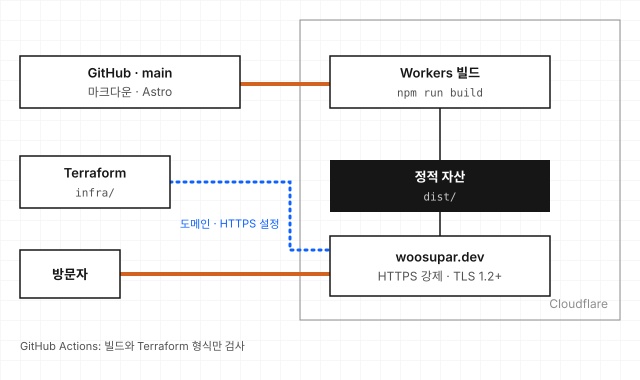

# personal-portfolio

[woosupar.dev](https://woosupar.dev)의 소스입니다. Astro로 만든 정적 사이트라 서버와 DB가 없고, 프로젝트 소개와 블로그 글은 모두 이 저장소의 마크다운 파일입니다.

## 구조



- `main`에 push하면 Cloudflare가 저장소를 받아 `npm run build`로 빌드하고 `dist/`를 올립니다. `wrangler.jsonc`가 그 설정입니다.
- 도메인 연결(Workers Custom Domain)과 HTTPS 강제, 최소 TLS 1.2 설정은 `infra/`의 Terraform으로 관리합니다.
- GitHub Actions는 push와 PR마다 사이트 빌드(`build.yml`)와 Terraform 형식 검사(`terraform.yml`)만 돌립니다. 배포는 하지 않습니다.

| 경로 | 내용 |
|---|---|
| `src/config.ts` | 이름, 첫 화면 문구, 연락처, 다루는 도구, 걸어온 길, 블로그 표시 여부 |
| `src/content/projects/` | 프로젝트 소개. 파일 이름이 주소가 됩니다 (`stock-market.md` → `/projects/stock-market/`) |
| `src/content/posts/` | 블로그 글 |
| `src/pages/`, `src/layouts/`, `src/components/` | 화면 구성 |
| `src/styles/global.css` | 색(라이트, 다크)과 글꼴 |
| `public/` | 이미지와 파비콘 |
| `infra/` | Cloudflare 도메인 설정 Terraform |

## 써 보려면

Node 22가 필요합니다(`.nvmrc`).

```bash
npm install
npm run dev      # http://localhost:4321
npm run build    # dist/ 에 정적 파일 생성
```

### 글 추가하기

`src/content/projects/`나 `src/content/posts/`에 마크다운 파일을 하나 만들면 됩니다. 머리말(frontmatter)의 항목은 `src/content.config.ts`에 정의되어 있고, 빠지거나 형식이 틀리면 빌드가 실패합니다.

```markdown
---
title: 프로젝트 이름
summary: 두세 줄 요약 (홈 화면 타일에 표시)
category: cloud          # net, cloud, auto, obs, dev 중 하나
period: '2026.01 – 2026.03'
tools: [Terraform, EKS]
draft: false             # true면 사이트에 나오지 않음
---

본문
```

### 알아 둘 것

- **`period`는 따옴표로 감쌉니다.** `2026.01`처럼 날짜 하나만 쓰면 따옴표가 없을 때 숫자로 읽혀 빌드가 깨집니다.
- **표의 첫 열은 줄바꿈되지 않습니다.** 본문 표의 첫 칸은 한 줄로 고정되는 스타일이라, 첫 칸에 긴 문장을 넣으면 휴대폰에서 표가 화면 밖으로 밀립니다.
- **`draft: true`인 글은 주소로도 열리지 않습니다.** 빌드 결과에서 아예 빠집니다.
